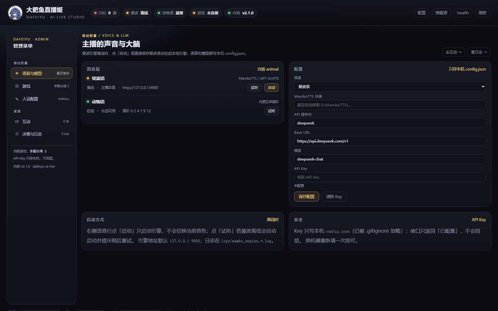
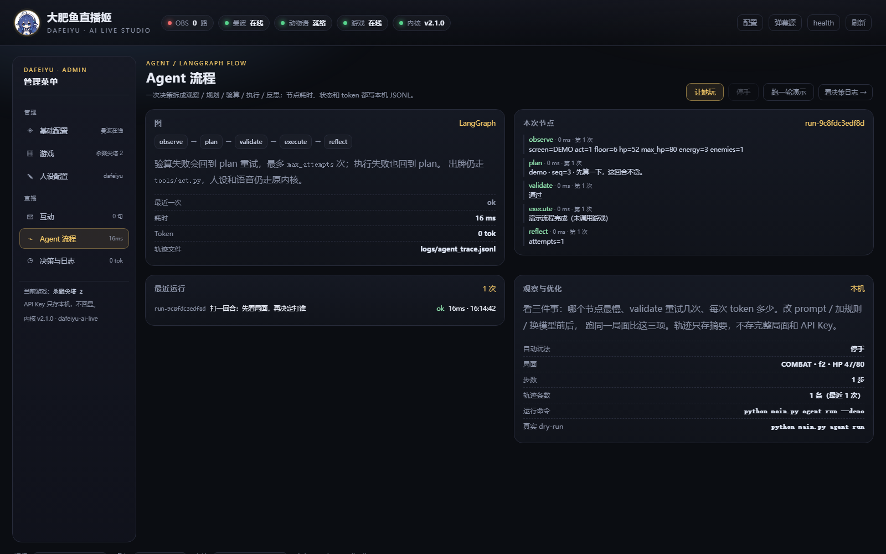
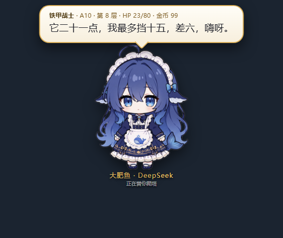
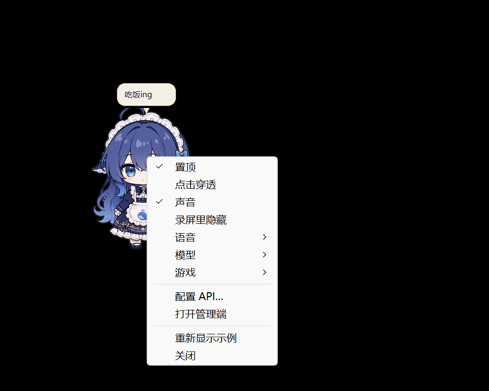

# 大肥鱼直播姬 · dafeiyu-ai-live

> 一个可换游戏、可换性格、可换声音的 **AI 直播工具**。
> 第一视角是《杀戮尖塔 2》铁甲战士 A10——但它只是「游戏列表」里的第一个包。

`v2.1` · Python 3.10+ · Windows（桌宠 / OBS） · 中文

---

## 这是什么

直播间里需要四样东西：**游戏在发生什么、主播怎么想、声音像不像人、画面给谁看**。
v1 把四样东西焊在一个「打杀戮尖塔」的工程里；v2 把它们拆成四层，游戏变成可插拔的包：

```
┌──────────────────────────── 大肥鱼直播姬 ────────────────────────────┐
│  UI 层        OBS 桌宠气泡 · 直播姬控制台 · 桌面桌宠（可拖、右键菜单）│
│  源码        事件总线 · 会话编排 · 配置 · CLI · 录像                   │
│  性格层      大肥鱼人设卡 · 通用 meme · 台词 lint · 节奏 / 招牌冷却    │
│  语音层      动物语（内置合成） · 曼波语（本地 GPT-SoVITS）            │
│  游戏列表    slay-the-spire-2：game-skill 适配器 + compat + 语料库     │
└──────────────────────────────────────────────────────────────────────┘
```

能做的事：

- **一键启动**：双击根目录 `start.bat`，或 `python main.py`。
- **桌宠右键菜单**：置顶 / 点击穿透 / 声音 / 录屏里隐藏 / **语音** / **模型** / **游戏** / **让她玩 ▸ 本地算账 / LLM 规划 / 慢速播报 / 普通节奏** / **让她停手** / **只启动游戏** / **配置 API** / **打开管理端** / 示例 / 关闭。
- **直播姬控制台** `http://127.0.0.1:8730/studio`：左侧经典管理端导航（基础配置 / 游戏 / 人设配置 / 互动 / Agent 流程 / 决策与日志），含语音、模型、游戏切换、决策日志、Token 估算和 Agent 节点轨迹。
- **OBS 桌宠弹幕**：浏览器源 `/`，大肥鱼精灵 + 漫画气泡，带逐像素 alpha，直接进录像。
- **桌面桌宠**：Win32 分层窗口，三视图精灵可拖；空闲气泡「吃饭ing」，决策「思考ing」，说话显示台词；默认能被录屏拍到（「录屏里隐藏」默认不勾）。
- **性格层**：改 `persona/dafeiyu/card.json` 就能换语气/禁语/招牌；通用梗放 `persona/memes/`。
- **语音层**：曼波语（MamboTTS）为主，引擎不在线时点「启动」/「试听」会自动拉起本地引擎，仍失败才回退动物语。
- **游戏切换**：桌宠右键「游戏 ▸」或管理端「游戏」页切换，写入 `config.game`，游戏适配器和 Agent 下一轮读取。
- **游戏启动**：右键「只启动游戏」、管理端按钮或 `python main.py game launch`，按 `game.json` 的 `launch` 拉起 Steam / exe。
- **让她玩**：右键「让她玩」二级菜单选**本地算账 / LLM 规划**；默认慢速播报，等语音再出下一步。战斗之外（奖励/地图/营火/事件）仍走本地，控制台也能切。自动玩默认自动开 OBS 录像，控制台「Agent 流程」能看到本轮累计 Token 和 LLM 回合数；开局不主动播报招呼，第一条台词从实际战斗/事件开始。当前只支持杀戮尖塔 2。
- **Agent 流程**：LangGraph 把一回合拆成观察 → 规划 → 验算 → 执行 → 反思，节点耗时/token/重试写本机轨迹，控制台「Agent 流程」可看。
- **录像回放**：自动玩开始即开录（OBS 没开会自动拉起），停止时收成 `recordings/<游戏>/run-NNNN/run.mp4`；同目录 `events.jsonl` / `chapters.md` / `timeline.json` 记录画面、楼层、战斗、台词和对应时间段，方便出混剪；`meta.json` 记角色/进阶/结果。
- **B 站礼物**：控制台「基础配置」填直播间房间号并勾选监听，桌宠会连 B 站直播 WebSocket，收到 `SEND_GIFT` / 醒目留言 / 上舰就让鱼绕两圈并气泡道谢；匿名被风控时再填可选 Cookie（只存本机，不回显）。
- **离线演示**：`python main.py demo` 不需要游戏，跑通「游戏 → 性格 → 语音 → UI」。



*控制台：左侧管理导航（基础配置 / 游戏 / 人设配置 / 互动 / Agent 流程 / 决策与日志），决策、日志、Token 和语音启动都在这里。*



*Agent 流程：observe → plan → validate → execute → reflect，节点耗时、状态和 token 都在本机轨迹里。*



*OBS 浏览器源：大肥鱼精灵 + 一句话气泡；桌宠窗用的是同一套三视图。*



*桌面桌宠：右键鱼身直接出菜单（置顶 / 点击穿透 / 声音 / 录屏里隐藏 / 语音 / 模型 / 游戏 / 让她玩 ▸ 本地算账 / LLM 规划 / 慢速播报 / 普通节奏 / 让她停手 / 只启动游戏 / 配置 API / 打开管理端 / 示例 / 关闭）。*

---

## 目录结构

```
dafeiyu-ai-live/
├── start.bat                    # 一键启动桌宠（pythonw）
├── main.py                      # 唯一根入口：桌宠 / CLI 都从这里进
├── ui/                          # 静态 UI 资产
│   ├── overlay/                 # OBS 浏览器源（透明气泡 + 动物语音效）
│   └── studio/                  # 直播姬控制台（单页，无外部依赖）
├── src/dafeiyu/                 # 所有 Python 源码
│   ├── core/                    # 事件总线 / 会话编排 / 配置
│   ├── persona/                 # 性格层实现：compose / lint / pacing / memes
│   ├── voice/                   # 语音层实现：animal / mambo / router
│   ├── ui/                      # 桌面桌宠、overlay 后端、状态机、单实例锁
│   │   ├── desktop.py           # 桌宠窗（Win32 + Pillow）
│   │   ├── overlay_server.py    # overlay + 控制台后端（:8730）
│   │   ├── caster_state.py      # 主播状态机
│   │   ├── instance_lock.py     # 单实例 / 重启接力
│   │   └── assets/pet/          # 正面/侧面/背面精灵（MIT，见 SOURCE.md）
│   ├── recording/               # 录制层：OBS 控制 + 自动玩会话 + 录像回放目录
│   │   ├── obs.py
│   │   ├── auto.py
│   │   └── replay.py
│   ├── games/                   # 游戏无关协议 + 注册表 + 演示源
│   │   ├── base.py
│   │   ├── registry.py
│   │   ├── launch.py            # Steam / exe / url 启动
│   │   └── demo.py
│   ├── agent/                   # LangGraph 回合流程 + 本机轨迹
│   │   ├── graph.py             # observe → plan → validate → execute → reflect
│   │   ├── tools.py             # ctx.py / act.py 适配 + 离线 DemoTools
│   │   ├── planner.py           # 外部 plan / OpenAI 兼容 LLM
│   │   └── trace.py             # logs/agent_trace.jsonl
│   └── cli.py                   # dafeiyu 命令
├── persona/                     # 性格层资产
│   ├── dafeiyu/                 # 人设卡 + 说话系统说明 + 19 句招牌
│   └── memes/                   # 通用 meme 梗（和具体游戏解耦）
├── voice/                       # 语音层资产：动物语音阶、曼波参考音配置
├── games/                       # 游戏列表
│   ├── registry.json
│   └── slay-the-spire-2/
│       ├── game.json            # 游戏包清单
│       ├── game-skill/          # 游戏技能层：adapter.py + 实况 runbook
│       ├── compat/              # 游戏兼容层：sts2.py 客户端 + mod + 补丁
│       └── corpus/              # 游戏语料库：sts2.db + 英文数据
├── recordings/                  # 录像回放：按游戏分目录，一局一个 run.mp4
│   ├── README.md
│   ├── INDEX.md
│   └── slay-the-spire-2/run-0094/{run.mp4,meta.json}
├── tools/                       # 决策/运维工具（A10 工作台、体检、TTS 看护、兼容 shim）
├── docs/                        # 玩法手册、复盘、教训
└── tests/                       # 直播姬单元测试
```

「中文名 → 路径」对照：

| 层 | 路径 | 说明 |
|---|---|---|
| 入口 | `main.py` | 无参数 = 桌宠；有子命令 = CLI |
| UI 资产 | `ui/` | `overlay`（OBS 源）、`studio`（控制台） |
| UI 代码 | `src/dafeiyu/ui/` | 桌宠 / overlay 后端 / 状态机 |
| 源码 | `src/dafeiyu/` | 内核 + CLI；不依赖具体游戏 |
| 性格层 | `persona/` + `src/dafeiyu/persona/` | 人设卡与 meme 是数据，lint/节奏是代码 |
| 语音层 | `voice/` + `src/dafeiyu/voice/` | 动物语 / 曼波语，路由负责回退 |
| 游戏列表 | `games/registry.json` | 每个游戏 = 一个包 |
| Agent 层 | `src/dafeiyu/agent/` | LangGraph 图 + 本机轨迹；工具仍走 `tools/ctx.py` / `tools/act.py` |
| 杀戮尖塔 2 | `games/slay-the-spire-2/` | `game-skill/` + `compat/` + `corpus/` |
| 录制 | `src/dafeiyu/recording/` + `recordings/` | 代码在 src，成品按游戏分目录 |
| 录像回放 | `recordings/<游戏>/run-NNNN/` | 一局一个 `run.mp4` + `meta.json` |

> 根目录只保留一个 Python 入口 `main.py`；老命令的兼容 shim 都在 `tools/`，
> 不再污染仓库根。

---

## 快速开始

```powershell
cd <克隆目录>
python -m pip install -r requirements.txt
# 可选：Agent 流程（LangGraph）
python -m pip install -e .[agent]

start.bat                    # 一键启动桌宠（pythonw，无控制台）
python main.py              # 或直接跑；右键鱼身打开菜单
python main.py studio       # 控制台 http://127.0.0.1:8730/studio
python main.py doctor       # 环境自检：人设卡 / 语音 / overlay / 语料库 / 游戏
python main.py demo         # 不需要游戏，跑一遍完整链路
python main.py agent run --demo  # 可选：离线跑一遍 Agent 图
```

`python main.py` 默认会在后台顺带起 overlay 服务（端口被占用就复用）；
只想开桌宠、不要服务时加 `--no-server`。桌宠参数（`--scale` / `--pos` / `--panel` /
`--preview` / `--click-through`）仍然可用：

```powershell
python main.py --scale 1.2 --pos 1200,600
python main.py --panel                 # 旧版横幅 UI
python main.py --preview out.png       # 只渲染一张图
```

录一局：

```powershell
python main.py replay start --character ironclad --ascension 10
# 打完
python main.py replay stop --result win_a10
python main.py replay list
```

控制台左侧是经典管理端导航：**基础配置 / 游戏 / 人设配置 / 互动 / Agent 流程 / 决策与日志**。可以直接：

- 写 `thought` + `meme` → 「只算 lint」看规则 / 「送到直播」推给 OBS 和桌面窗；
- 看 **决策记录**（thought / 实际台词 / token 估算）和 **运行日志**；
- 看 **Agent 流程**：最近运行的节点耗时、重试次数、token 和轨迹；
- 切 **语音**、**模型**、**当前游戏**，配置 **API 提供方 / Base URL / API Key**；
- 点「只启动游戏」直接拉起 Steam / exe（按 `game.json` 的 `launch` 配置）；点「让她玩」启动后自动跑一局；
- 曼波离线时点「启动」或「试听」自动拉起本地 MamboTTS；
- 看游戏包是否在线、语料库多大、overlay 当前几路连接。

离线演示的输出长这样：

```
  [演示角色 · A10 · F6 · HP 52/80 · COMBAT]
  大肥鱼> 它 21，我最多挡 15。差 6，嗨呀。
  [演示角色 · A10 · F6 · HP 47/80 · COMBAT]
  大肥鱼> 9 点，它 9 血。刚好够。
```

## 桌宠与气泡

- 精灵来自 [1190fasheqi/dafeiyu-pet](https://github.com/1190fasheqi/dafeiyu-pet)（MIT），
  只保留正面 / 侧面 / 背面三张图，**没有逐帧动画**：呼吸、摇摆、倾斜、拉伸、速度线、
  松手回弹都是 `src/dafeiyu/ui/desktop.py` 实时画的。
- 鼠标拖动方向决定朝向：左右 → 侧面（自动镜像）、向上 → 背面、向下 → 正面；
  拖得越快倾斜越大，松手 0.45 秒回正。
- 说话是漫画气泡：奶白底 + 金边 + 尾巴，出现淡入上浮，说完 1.6 秒淡出；
  思考中显示「思考ing」，不会一直挂着上一句。
- 窗口空白像素不吃鼠标：只有鱼身和气泡可点，其余点击直接落到游戏里。
- **右键鱼身**：置顶 / 点击穿透 / 声音 / 录屏里隐藏 / **语音**（曼波 / 动物语 / 静音）/ **模型** / **游戏** / **让她玩 ▸ 本地算账 / LLM 规划 / 慢速播报 / 普通节奏** / **让她停手** / **只启动游戏** / **配置 API…** / **打开管理端** / 重新显示示例 / 关闭。
- **语音未就绪**：点「曼波语」或语音子菜单的「启动曼波引擎」会后台拉起 `run_engine.py`；控制台语音行的「启动」/「试听」也会自动启动。
- **三态气泡**：空闲「吃饭ing」，决策「思考ing」，说话显示这一句台词。
- **录屏可见性**：「录屏里隐藏」默认不勾，桌宠默认会进录像；勾上后用 `WDA_EXCLUDEFROMCAPTURE` 排除。要启动即隐藏可加 `--exclude-capture`。
- `python main.py` 默认桌宠；`--panel` 回旧版横幅，`--preview out.png` 只渲染不上屏。

## B 站礼物

控制台「基础配置」里填 **B 站直播间**（`https://live.bilibili.com/12345` 里的 `12345`），
勾选「开启 B 站礼物监听」，桌宠进程会：

- 取 B 站 `getDanmuInfo`（带 WBI 签名）并连直播 WebSocket；
- 心跳保持连接，断线自动重连；
- 收到 `SEND_GIFT`、醒目留言、上舰时，鱼身绕小圈转两圈 + 金色星星，并气泡道谢；
- 状态写 `logs/bilibili.json`，控制台会显示「监听中 / 连接失败」。

匿名请求被 B 站风控（错误 `-352`）时，在同一张配置卡里填 `SESSDATA` Cookie；
Cookie 只写本机 `config.json`，接口只返回「已配置」，不会回显。房间号/Cookie
改了之后桌宠会自动重连，不用重启。礼物动画在桌宠上；OBS 里的 overlay 页面不额外画脸。

## 录像回放

```text
recordings/
├── README.md
├── INDEX.md
└── slay-the-spire-2/
    └── run-0094/
        ├── run.mp4
        ├── meta.json
        ├── events.jsonl       # 视频秒数 + 画面/楼层/战斗/台词事件
        ├── chapters.md        # 开始/结束时间段，直接照着剪
        └── timeline.json      # 机器可读的完整时间轴
```

- `python main.py replay start` 建当前局、把 OBS 录像目录指过去并开录；
- `python main.py replay stop --result ...` 停录、收成该局唯一的 `run.mp4`、写 meta 和索引；
- 自动玩的 `events.jsonl` / `chapters.md` / `timeline.json` 与 `run.mp4` 同目录，停止时一起收尾；
- 一局一个视频，重复录制默认不覆盖（`--force` 才换）；多出来的段进 `_extra/`；
- 视频不入 Git，只提交 `README.md` 和 `INDEX.md`；旧的散放 mp4 已迁进分游戏目录。

---

## 四层怎么协作

一句话台词只走一条链路，任何一层挂了都不拦下一层：

```
游戏适配器 ──GAME_STATE──┐
                        ├─► EventBus ─► UI（/state、控制台）
Agent / 控制台 ──say()──┤
                        ├─► Persona（拼句、lint、节奏）
                        │        └─► COMMENTARY_SAY
                        ├─► OverlayPublisher ──POST /comment──► OBS + 桌面窗
                        └─► VoiceRouter（后台线程）──VOICE_READY──► 统计 / 控制台
```

- **`LiveSession.say(thought, meme)`** 是唯一出口：拼句 → lint → 推送 → 后台配音。
- 事件主题见 `src/dafeiyu/core/events.py`（`game.*` / `commentary.*` / `voice.*`）。
- 配音永远在后台线程，UI 推送从不等待 TTS；曼波超时/离线自动回退动物语。

```python
from dafeiyu.core.config import LiveConfig
from dafeiyu.core.session import LiveSession

session = LiveSession(LiveConfig.load()).start()
session.say("它 21，我最多挡 15", "差 6，嗨呀。")
```

---

## Agent 流程（LangGraph）

内核仍然只做规则、节奏和分发；Agent 层只接在**一回合的边界**上：

```
observe ──► plan ──► validate ──► execute ──► reflect
              ▲          │            │
              └──────────┴────────────┘   验算/执行失败 → 回 plan 重试
```

- `observe` 复用 `tools/ctx.py` 的紧凑局面；`validate` 复用 `tools/act.py --dry` 的硬护栏；
- `plan` 可以来自外部 DSH Agent（`--plan`，继续用 `.dsh/skills`）或内置 LLM；
- 默认 dry-run，只有 `python main.py agent run --execute` 才真的出牌；
- 每个节点的耗时/状态/token/重试写 `logs/agent_trace.jsonl`，控制台左侧「Agent 流程」直接看；
- 不走 LangSmith 云端，轨迹只存摘要，不存完整局面和 API Key。

```powershell
python main.py agent run --demo          # 离线验证图
python main.py agent run                 # 真实局面 + LLM，只验算
python main.py agent run --plan plan.json  # 外部 Agent 出计划
python main.py agent trace --limit 5
```

完整取舍、状态字段和优化方法见 [`docs/AGENT_LANGGRAPH.md`](docs/AGENT_LANGGRAPH.md)。

---

## 性格层

- 人设卡：`persona/dafeiyu/card.json`（长度阈值、禁语、招牌 19 句、口癖、开场/收尾）。
- 说话系统说明：`persona/dafeiyu/style.md`（人设、三拍、五件武器、梗的纪律、出口前三问）。
- 通用 meme：`persona/memes/general.json`，代码 `src/dafeiyu/persona/memes.py`。
- 实现：`src/dafeiyu/persona/`。

规则和 v1 的 `tools/check_caster.py --say` 同一套口径：

| 规则 | 阈值 |
|---|---|
| 长度 | > 60 字 WARN，> 85 字 FAIL |
| 自称/标签 | 「大肥鱼：」「分析：」「战斗：」→ FAIL |
| 复读 | 「典/寄/就这…」一条 ≥2 次 → FAIL |
| 招牌 | 一句最多一句，10 分钟冷却，无数字垫着 → WARN |
| 数字 | 没有数字 → WARN（空话） |

```powershell
python main.py say --thought "它 21，我最多挡 15" --meme "差 6，嗨呀。"
# 大肥鱼> 它 21，我最多挡 15。差 6，嗨呀。
#   lint  PASS (0 fail / 1 warn)
#   push  ok id=1024
#   voice mambo 2.31s
```

新人设：复制 `persona/dafeiyu/` 改名，在 `config.json` 写 `{"persona": "<id>"}`。

---

## 语音层

| 语音 | 实现 | 引擎 | 何时用 |
|---|---|---|---|
| 曼波语 | `src/dafeiyu/voice/mambo/` | 本地 MamboTTS / GPT-SoVITS `:9880` | 主配音 |
| 动物语 | `src/dafeiyu/voice/animal/` | 纯 Python 五声音阶合成 | 回退；OBS 页面同款音效 |

```powershell
python main.py voice test "它 21，我最多挡 15。差 6，嗨呀。" --voice animal
python main.py voice test "..." --voice mambo
python main.py voice status
```

- 曼波引擎不在仓库里（模型太大）：起引擎后把参考音频填进 `voice/mambo/ref.json` 的 `ref_wav`，
  或设 `STS2_TTS_REF`；合成结果缓存在 `logs/tts_cache/`。
- 引擎没起时，桌宠语音菜单 / 控制台「启动 / 试听」会调用 `src/dafeiyu/voice/startup.py`：
  默认从 `D:\MamboTTS\app\MamboTTS-v1.2.1-full` 拉起 `run_engine.py`；目录不同就设
  `DAFEIYU_MAMBO_DIR`（或控制台「MamboTTS 目录」）。
- 引擎连续失败由 `tools/tts_guard.py --auto` 拉起看护；掉线时路由自动回退动物语。
- 同一个进程里曼波串行合成（锁 + 缓存），不会并发压引擎。

---

## 游戏列表

```powershell
python main.py games
# ○ 离线  杀戮尖塔 2     slay-the-spire-2   Steam · 2868840
# ● 在线  演示信号源     demo               内置
```

当前游戏用桌宠右键「游戏 ▸」或管理端「游戏」页切换，写到 `config.game`；不会重启游戏或 Agent。
右键「只启动游戏」、管理端「游戏」页或 `python main.py game launch` 会按 `game.json` 的
`launch` 启动；切游戏只改配置，不自动拉起游戏。

```json
{"launch": {"type": "steam", "app_id": "2868840"}}
{"launch": {"type": "exe", "path": "bin/game.exe", "args": ["--windowed"]}}
```

支持 `steam`（Steam App ID）、`exe`（相对游戏包目录或绝对路径）、`url`；没写 `launch` 的游戏
（例如内置演示）会明确报「未配置启动方式」。游戏专属代码仍放各自 `game-skill/`，注册表在
`games/registry.json`。

### 让她玩（自动跑一局）

```powershell
python main.py play              # 启动游戏 + 自动跑；Ctrl+C 停
python main.py play --mode llm   # 战斗回合交给 LLM（需要 API Key）
python main.py play --pace voice # 慢速，等语音；默认就是 voice
python main.py play --stop       # 从另一个进程停手
```

桌宠右键「让她玩」是二级菜单：

- **本地算账**：`tools/advisor.py` 算伤害/格挡/斩杀，不烧 token；
- **LLM 规划**：战斗回合进 LangGraph `observe → plan → validate → execute`，默认用
  `deepseek-chat`（非推理模型，避免长局面把 content 挤空），轨迹仍写
  `logs/agent_trace.jsonl`；规划/验算/执行失败都会按最新手牌用本地兜底，不再整局停手；
- 右键「模型」会同时改 `llm_model` 和 `autoplay_llm_model`；
  自动玩运行中改，下一个 LLM 回合生效，不用重开；
- **慢速播报**：按上一句台词长度估算播完时间，至少留 2 秒再出下一步；
- **普通节奏**：旧版 0.7 秒，适合静音或只想快进。

管理端「Agent 流程」里的「玩法 / LLM 模型 / 播报节奏」和右键菜单是同一份
`config.json`。当前只对杀戮尖塔 2 开放，流程是：

- `MAIN_MENU / CHARACTER_SELECT`：没局就开 A10 铁甲战士；
- `COMBAT`：本地模式走 `advisor.py` + `sts2 batch`；LLM 模式走 `run_turn` + `act.py`；
- `REWARD`：`sts2.py rewards --pick auto` 自动挑牌/空收；
- `MAP`：用 `sts2.py route` 的路线计划选下一格；
- `REST / EVENT / SHOP / CHEST`：保守选择（低血休息、事件第一项、商店先离开）；
- `GAME_OVER`：回主菜单开新一局；想停手点「让她停手」；
- 未知界面：停在那一步并写日志，不猜按钮。

进展写 `logs/autoplay.json` 和 `logs/autoplay.jsonl`，其中包括 API 实际 token
（`tokens_in/out/total`、`llm_calls`）和录像状态；可以从另一个进程停：
`python main.py play --stop`（桌面/管理端都调用它）。本地模式是整局循环；
LLM 模式只在战斗回合进入 LangGraph，非战斗界面仍走本地，避免每个地图节点都烧 token。

以《杀戮尖塔 2》为例，一个游戏包只有三份东西：

| 目录 | 职责 | 内容 |
|---|---|---|
| `game-skill/` | 游戏技能层 | `adapter.py`（读状态 → `GAME_STATE`）、A10 runbook、游戏专属梗 |
| `compat/` | 游戏兼容层 | `sts2.py` 客户端、mod DLL、兼容补丁、状态字段约定 |
| `corpus/` | 游戏语料库 | `sts2.db`（626 卡 / 127 敌 / 311 遗物 / 118 梗 / 226 条规则）、英文数据 |

适配器 `games/slay-the-spire-2/game-skill/adapter.py` 只做「读状态 → GAME_STATE 事件」，
不替玩家出牌。出牌/决策仍走兼容层 CLI + 决策技能（`.dsh/skills/sts2-ironclad-ironclad`）。
`src/dafeiyu/games/` 里只有游戏无关的协议、注册表和演示源。

### 加一个新游戏

1. 在 `games/<新游戏>/` 放 `game.json` + `game-skill/` + `compat/` + `corpus/`；
2. 在 `game-skill/adapter.py` 实现 `GameAdapter`（`available()` / `snapshot()` / 可选 `events()`）；
3. 在 `games/registry.json` 注册 `adapter: "game-skill/adapter.py:类名"`；
4. `python main.py games` 能看到、`status()` 能连上即可。

---

## 杀戮尖塔 2 实况（v1 工作流继续可用）

根目录不再放 shim；老脚本仍可从 `tools/` 找到同名入口：

```powershell
python tools/sts2.py state            # 游戏状态（mod :8080）
python main.py game state             # 走注册表读状态（新写法）
python tools/ctx.py                   # 结构化局面包
python tools/act.py --file plan.json  # 校验并执行牌序
python main.py obs status             # OBS 状态
python main.py obs start|stop         # 裸 OBS 开关；正式录像用 replay start/stop
python main.py obs health             # 出帧/音频/后台静音自检
python tools/live.py check            # 主播链路体检
python tools/live.py watch            # 长时间直播看护
python main.py                        # 桌面桌宠（--panel 旧横幅）
python main.py studio                 # 只起弹幕服务 + 控制台
```

完整开局流程、A10 硬规则、复盘模板见 [`games/slay-the-spire-2/game-skill/NEXT_PROMPT.txt`](games/slay-the-spire-2/game-skill/NEXT_PROMPT.txt)、
[`QUICKSTART.md`](QUICKSTART.md)、[`docs/`](docs/)。直播姬这边建议：

```powershell
python main.py studio    # 先起服务和 OBS 源
python main.py status    # 再确认四层都在线
```

OBS 场景仍叫 `StS2`：`StS2 Game`（game_capture）+ `AI Commentary`（浏览器源 → `127.0.0.1:8730`）+
`StS2 Audio`（进程音频）。

---

## 控制台 API

| 方法 | 路径 | 用途 |
|---|---|---|
| GET | `/` | OBS 桌宠气泡页 |
| GET | `/studio` | 直播姬控制台 |
| GET | `/api/studio` | 四层状态 + 最近决策/日志/Token + 游戏包 |
| GET | `/api/config` | 语音/模型/游戏/API 配置（Key 只返回是否已配置） |
| POST | `/api/config` | 保存语音/模型/游戏/API/自动玩法；Key 只写本机 `config.json` |
| GET | `/api/games` | 游戏列表（强制刷新在线状态） |
| POST | `/api/game/launch` | `{game}` 只启动游戏；默认当前 `config.game` |
| POST | `/api/play/start` | `{mode?, pace?}` 启动自动玩；返回 `already` 或状态 |
| POST | `/api/play/stop` | 请求停手（跨进程写 stop 文件） |
| POST | `/api/agent/run` | 跑一轮离线 Agent 演示（不碰游戏） |
| POST | `/api/say` | `{thought, meme}` 或 `{text}`；`dry_run: true` 只 lint |
| POST | `/api/voice` | `{text, voice}` 返回 WAV；曼波离线会自动启动并返回 202 |
| POST | `/api/voice/start` | `{voice: "mambo"}` 启动本地曼波引擎 |
| GET | `/health` | overlay 连接数 / TTS 统计 / 播放状态 |
| GET | `/tts?text=...` | 页面与桌面窗共用的曼波合成缓存 |

### API Key 安全

- 只写本机根目录 `config.json`；该文件已被 `.gitignore` 忽略，不会进仓库。
- `/api/studio`、`/api/config` 只返回 `llm_api_key_set`，**不回显 Key**；控制台输入框也不会回填。
- Key 不写日志、不写 `recordings/`、不写决策记录。
- 换机器时重新填一次；不要把自己填过 Key 的 `config.json` 发给别人。

---

## 测试

```powershell
python -m pytest -q tests          # 直播姬：总线/性格/语音/游戏/启动/配置/Agent/自动玩法/录像/B站（71 项）
python tools/test_ctx_act.py       # 决策层：ctx + act（离线）
python tools/test_streamer.py      # 桌宠渲染/透明/换行/配音
python tools/test_overlay_playback.py
python main.py doctor              # 环境自检
```

---

## v1 → v2 改了什么

| v1 | v2 | 兼容 |
|---|---|---|
| `overlay/` | `ui/overlay/` | 服务内路径已改 |
| `streamer.py` | `src/dafeiyu/ui/desktop.py` | `tools/streamer.py` shim |
| `overlay_server.py` | `src/dafeiyu/ui/overlay_server.py` | 由 `main.py studio` 启动 |
| `obsctl.py` | `src/dafeiyu/recording/obs.py` | `tools/obsctl.py` shim / `main.py obs` |
| `sts2.py` | `games/slay-the-spire-2/compat/sts2.py` | `tools/sts2.py` shim |
| `mod/` | `games/slay-the-spire-2/compat/mod/` | 文档同步 |
| `db/` | `games/slay-the-spire-2/corpus/db/` | `python main.py setup` 建链接 |
| `tools/data/` | `games/slay-the-spire-2/corpus/data/` | 同上 |
| — | `persona/memes/`、`src/dafeiyu/recording/`、`game-skill/`、`main.py` | 新增 |

> `db/` 和 `tools/data/` 是 NTFS 目录链接（Windows）或符号链接（POSIX），只为让 v1 脚本的相对路径继续工作；
> 真实内容始终在 `games/slay-the-spire-2/corpus/`。克隆后跑一次 `python main.py setup` 即可。

---

## 已知限制

- 桌面桌宠和 OBS 控制在 Windows 上验证；Linux/macOS 只有 overlay + 控制台。
- 游戏兼容层针对 **v0.107.1 + STS2-Agent v0.8.0**；游戏升级后需重新验证 mod（见 `game.json` 的 `compat.checks`）。
- 曼波引擎、参考音频、OBS 场景都是本机外部依赖，仓库不包含模型和录像。
- 语料库来自公开 Wiki + mod 自带数据 + 本地实战记录；仅用于本地研究与直播，不再分发游戏资源。

## 开源协议

本项目代码用 **MIT License**，见根目录 [`LICENSE`](LICENSE)，版权归 lxllxl233。

第三方素材各自保留原协议：

- 桌宠精灵：[1190fasheqi/dafeiyu-pet](https://github.com/1190fasheqi/dafeiyu-pet)（MIT），
  副本与署名在 `src/dafeiyu/ui/assets/pet/LICENSE`、`SOURCE.md`；
- 游戏名、卡牌/角色数据版权归 Mega Crit 与原作；`compat/mod/` 里的 mod 二进制归其作者；
- 语料库只用于本地研究与直播，不再分发游戏资源。

## 声明

- 游戏名、卡牌/角色数据版权归 Mega Crit 与原作者；`compat/mod/` 里的 mod 二进制版权归其作者。
- 本项目代码用于个人直播与学习；商用/再分发前请自行确认第三方素材授权。
