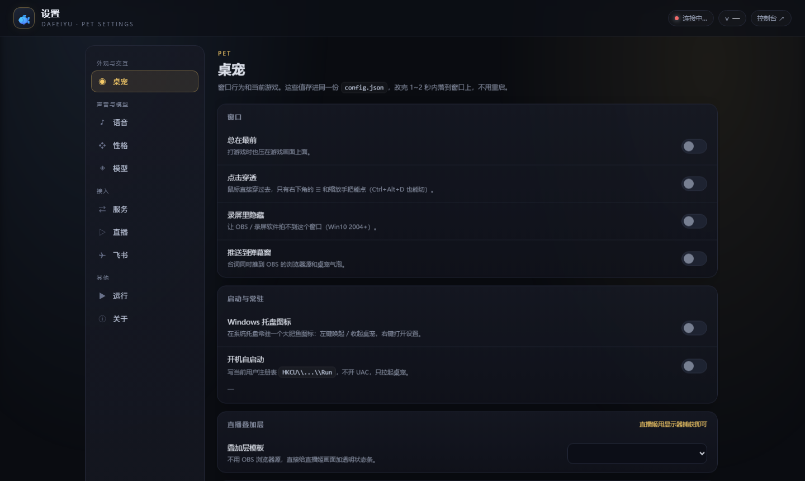
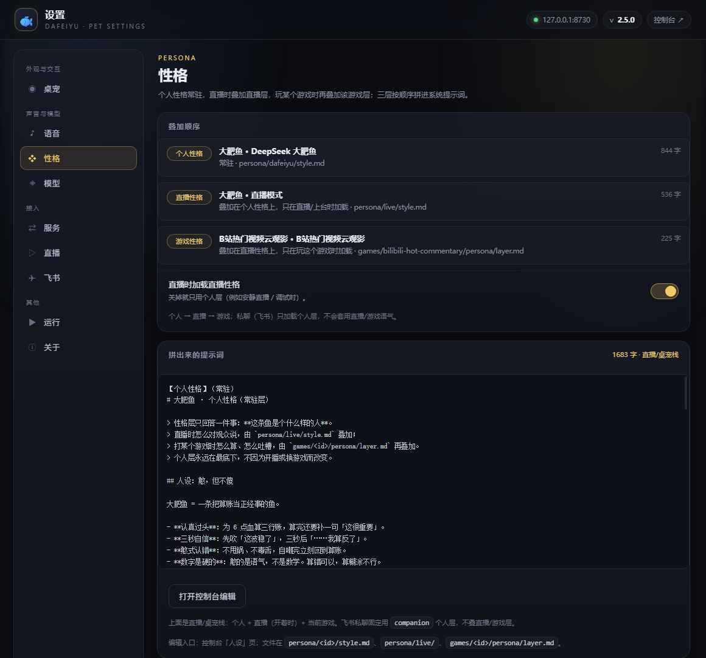

# 大肥鱼直播姬 · dafeiyu-ai-live

> 一个可换游戏、可换性格、可换声音的 **AI 直播工具**。
> 第一视角是《杀戮尖塔 2》铁甲战士 A10——但它只是「游戏列表」里的第一个包。

`v2.5` · Python 3.10+ · Windows（桌宠 / OBS） · 中文

---

## 一分钟看懂

直播需要四件事：**游戏在发生什么、主播怎么想、声音像不像人、画面给谁看**。
这个项目把它们拆成四层，游戏和性格都是可插拔的包：

```text
┌──────────────────────────── 大肥鱼直播姬 ────────────────────────────┐
│ UI 层       OBS 浏览器源 · 桌面桌宠 · 设置页 · 直播姬控制台          │
│ 源码层      事件总线 · 会话编排 · 配置 · CLI · 录像                   │
│ 性格层      大肥鱼人设卡 · 通用 meme · 台词 lint · 节奏 / 招牌冷却    │
│ 语音层      动物语（内置合成） · 曼波语（本地 GPT-SoVITS）            │
│ 游戏列表    slay-the-spire-2 / vampire-survivors / B站云观影 / ...    │
└──────────────────────────────────────────────────────────────────────┘
```

核心不写死任何游戏：切换游戏只改 `config.game`，游戏包自己声明
`observe / validate / execute / autoplay` 能力。内置 `toy-duel` 用来证明
“换一个完全离线的游戏也能跑”。

---

## 能做什么

- **桌面桌宠**：Win32 透明分层窗口，三视图精灵可拖；空闲「吃饭ing」，决策「思考ing」，说话弹漫画气泡。右键鱼身会在右侧弹出蓝色设置齿轮，点开是分组设置页；默认能被录屏拍到，也可以选「录屏里隐藏」。
- **直播姬控制台**：`http://127.0.0.1:8730/studio`，左侧是基础配置 / 游戏 / 人设配置 / 直播间 / 互动 / Agent 流程 / 决策与日志。语音、模型、游戏、B 站互动、Token 账单和 Agent 轨迹都在这里。
- **OBS 桌宠弹幕**：浏览器源 `/`，大肥鱼精灵 + 漫画气泡，带逐像素 alpha，直接进录像。
- **桌面叠加层**：设置页可选状态条 / 电影框 / 弹幕栏 / 极简字幕，窗口置顶、点击穿透，跟随桌宠所在屏幕；不用 OBS 也能给直播姬加透明叠层。
- **B 站直播间**：监听进入 / 关注 / 点赞 / 弹幕 / 礼物 / 醒目留言 / 上舰，桌宠会用气泡和动画回应；控制台能筛选事件、直接发弹幕（需要登录 Cookie）。
- **B站热门视频云观影**：按 B 站专属人设搜片、选片，用独立 Chrome profile 的 app 窗口播放，只读弹幕时间轴；支持 AI 评论、开场/收尾、弹幕回复和 `/bili` 直播场景页。
- **KOOK 聊天**：机器人走 WebSocket 长连接，不需要公网 IP；支持文字、看图、1–3 条连发、偶尔主动开口、语音音频卡片和大肥鱼表情包，对话记忆存本机 SQLite。语音优先转 MP3，并带「重听」按钮，避开手机端内嵌播放器重播没声音的问题。
- **让她玩**：本地算账 / LLM 规划两种模式。LLM 模式下所有玩家决策都进模型，本地启发式只在超时或输出不可执行时兜底；默认慢速播报，等语音再走下一步。
- **LLM 直播模式（导演）**：导演从各游戏包 `game.json` 的 `live` 声明里挑下一段播什么、播多久、说一句过渡台词，然后停当前模块、切游戏、重新开播；模型不可用时按顺序轮换。
- **录像回放**：自动玩按游戏策略开 OBS，杀戮尖塔 2 / 吸血鬼幸存者默认一局一个视频；停止时收成 `recordings/<游戏>/run-NNNN/run.mp4`，同目录带 `meta.json`、`events.jsonl`、`chapters.md`、`timeline.json`。
- **真实 Token 账单**：自动玩每次 LLM 调用、KOOK 每次回复 / 记忆抽取 / 压缩都写本机 usage；控制台把两份账单合并，按来源、类型和每一步展示，不是估算。
- **Agent 流程**：LangGraph 把一回合拆成观察 → 规划 → 验算 → 执行 → 反思，节点耗时 / token / 重试写本机轨迹。
- **离线演示**：`python main.py demo` 不需要游戏，跑通「游戏 → 性格 → 语音 → UI」。

---

## 界面


*控制台：左侧管理导航，B 站互动、Token 账单、决策日志和语音启动都在这里。*


*Agent 流程：observe → plan → validate → execute → reflect，节点耗时、状态和 token 都在本机轨迹里。*


*OBS 浏览器源：大肥鱼精灵 + 一句话气泡；桌宠窗用的是同一套三视图。*


*右键鱼身：蓝色齿轮按钮紧贴鱼身右侧弹出；弹出后 5 秒不点自动收起。[动图预览](docs/settings-bubble.webp)*



*设置页：桌宠 / 语音 / 性格 / 模型 / 服务端口 / 直播 / KOOK / 运行 / 关于，保存即生效。*



*性格三层：个人常驻 → 直播叠加 → 该游戏再叠加；右侧预览是真正拼进系统提示词的文本。*


*直播间互动：点赞出爱心、弹幕显示内容、进直播间「欢迎 名字」、送礼物出大米饭。*

---

## 快速开始

```powershell
cd <克隆目录>
python -m pip install -r requirements.txt

# 可选：Agent 流程（LangGraph）
python -m pip install -e .[agent]

start.bat                         # 一键启动桌宠（pythonw，无控制台）
python main.py                    # 直接跑；右键鱼身紧贴弹出设置齿轮
python main.py studio             # 控制台 + overlay：http://127.0.0.1:8730/studio
python main.py doctor             # 环境自检
python main.py demo               # 不需要游戏，跑一遍完整链路
python main.py agent run --demo   # 可选：离线跑一遍 Agent 图
```

`python main.py` 默认会在后台顺带起 overlay 服务（端口被占用就复用）；
只想开桌宠、不要服务时加 `--no-server`。桌宠参数仍然可用：

```powershell
python main.py --scale 1.2 --pos 1200,600
python main.py --panel             # 旧版横幅 UI
python main.py --preview out.png   # 只渲染一张图
```

### 常用命令

| 想做什么 | 命令 |
|---|---|
| 打开桌宠 | `start.bat` 或 `python main.py` |
| 打开控制台 / OBS 源 | `python main.py studio` |
| 环境自检 | `python main.py doctor` |
| 看游戏列表 | `python main.py games` |
| 只启动当前游戏 | `python main.py game launch` |
| 让她玩一局 | `python main.py play` |
| LLM 决策跑一局 | `python main.py play --mode llm` |
| 停手 | `python main.py play --stop` |
| 开启 / 停止直播导演 | `python main.py live` / `python main.py live --stop` |
| 看导演状态 | `python main.py live --status` |
| 启动 KOOK 机器人 | `python main.py kook` |
| 只校验 KOOK Token | `python main.py kook --check` |
| 录一局 / 收尾 / 列表 | `python main.py replay start` / `stop` / `list` |
| 说一句并 lint / 配音 | `python main.py say --thought "..." --meme "..."` |
| Agent 离线演示 | `python main.py agent run --demo` |

完整开局流程、A10 硬规则和复盘模板见
[`QUICKSTART.md`](QUICKSTART.md)、[`games/slay-the-spire-2/game-skill/NEXT_PROMPT.txt`](games/slay-the-spire-2/game-skill/NEXT_PROMPT.txt)
和 [`docs/`](docs/)。

---

## 桌宠与设置页

- 精灵来自 [1190fasheqi/dafeiyu-pet](https://github.com/1190fasheqi/dafeiyu-pet)（MIT），只保留正面 / 侧面 / 背面三张图，没有逐帧动画；呼吸、摇摆、倾斜、拉伸、速度线、松手回弹都是实时画的。
- 鼠标拖动方向决定朝向：左右 → 侧面（自动镜像）、向上 → 背面、向下 → 正面；拖得越快倾斜越大，松手 0.45 秒回正。
- 说话是漫画气泡：奶白底 + 金边 + 尾巴，出现淡入上浮，说完 1.6 秒淡出；思考中显示「思考ing」，不会一直挂着上一句。
- 窗口空白像素不吃鼠标：只有鱼身和气泡可点，其余点击直接落到游戏里。
- **右键鱼身**：紧贴右侧弹出蓝色齿轮按钮，点一下打开设置页 `http://127.0.0.1:8730/settings`。页面和桌宠读写同一份 `config.json`，保存后 1~2 秒内跟上；改端口要点「重启桌宠」应用。
- **托盘与自启动**：设置页「启动与常驻」可开 Windows 托盘图标（左键唤起 / 收起，右键打开设置）和开机自启动（写 HKCU Run，不需要管理员）。
- **叠加层模板**：状态条 / 电影框 / 弹幕栏 / 极简字幕；选中的模板会记住，下次启动自动恢复。
- **语音未就绪**：设置页「语音 → 启动引擎」或控制台「启动 / 试听」会后台拉起 `run_engine.py`；「关闭引擎」只杀 python/pythonw 进程树，释放内存。
- `python main.py --panel` 回旧版横幅，`--preview out.png` 只渲染不上屏。

---

## KOOK 聊天

KOOK 是独立进程，桌宠只负责按 `kook_enabled` 拉起 / 收起它；
`logs/kook/service.lock` 保证手动启动和桌宠不会各开一条连接。

**第一次接入：**

1. 在 [KOOK 开发者中心](https://developer.kookapp.cn/app) 新建应用，打开机器人 **WebSocket 连接模式**，复制 Token；
2. 用「邀请链接」把机器人邀请进服务器，给文字消息 / 发送消息 / 查看频道权限；
3. 设置页「KOOK」填 Token、打开「启用 KOOK 聊天」，保存后 1~2 秒自动拉起；
4. 也可以手动跑：

```powershell
python main.py kook --check   # 只校验 Token / LLM / 记忆库，不打印 Token
python main.py kook           # 常驻；Ctrl+C 停止
```

**聊天能力：**

- 频道 @ 或私聊都可以；文本和 KMarkdown 都会处理，`(met)...(met)` 提及会清掉；
- **图片**：直接发图片，或网页端粘贴 / 拖拽（会变成卡片消息）；服务会下载给视觉模型看，再回复看到的内容；
- **多条回复**：模型可以一次给 1–3 条短消息，服务按顺序发成独立气泡；只有第一条引用原消息；
- **主动消息**：安静一阵后偶尔主动找最近聊过的频道 / 私聊说一句。默认开，`kook_proactive_minutes` 控制最短安静时间，实际还会再随机等几分钟；发过一次后要等对方回话才重新计时，不会连续轰炸；
- **语音**：模型判断适合时，回复带一张「大肥鱼语音 · Ns」音频卡片。KOOK 机器人不能直发 `type=8` 音频消息，所以走官方卡片的 `audio` 模块；TTS 的 WAV 优先转 **MP3** 再上传，卡片同时带「重听」按钮，手机端内嵌播放器第二次没声音时可以点按钮用浏览器播放；
- **表情包**：从 `persona/stickers/` 里挑一张，用图片消息发出来；
- **记忆**：默认开启，最近 N 条原文 + 摘要进上下文，事实存本机 `logs/kook/memory.db`；超过阈值自动把最老的一段压成摘要，原文仍保留；
- 机器人自己发的消息、系统消息、视频 / 文件不会回复。

**关键配置：**

| 字段 | 默认 | 说明 |
|---|---|---|
| `kook_enabled` | false | 桌宠是否自动拉起 KOOK 服务 |
| `kook_bot_token` | 空 | Bot Token；只存本机，不回显 |
| `kook_persona` | `companion` | 聊天人设，只加载个人层 |
| `kook_memory` | true | 本地 SQLite 长期记忆 |
| `kook_context_turns` | 12 | 每次带给模型的最近原文条数 |
| `kook_summary_trigger` | 24 | 未压缩对话超过多少条时压摘要 |
| `kook_allow_voice` | true | 允许模型发语音卡片 |
| `kook_stickers` | true | 允许模型配大肥鱼表情包 |
| `kook_proactive` | true | 安静一阵后偶尔主动发消息 |
| `kook_proactive_minutes` | 60 | 最短安静分钟数（10–720） |
| `kook_allowed_users` | `[]` | 只允许这些用户 id；空 = 不限制 |

日志：`logs/kook/events.jsonl`（只记类型 / 字数 / 耗时，不记正文）、
`logs/kook/usage.jsonl`（Token 账单）、`logs/kook/service.log`。
完整配置、权限和排错见 [`docs/KOOK.md`](docs/KOOK.md)。

---

## B 站直播间

控制台「基础配置」里填 **B 站直播间房间号**（`https://live.bilibili.com/12345` 里的 `12345`），
勾选「开启 B 站礼物监听」，桌宠进程会：

- 取 `getDanmuInfo`（带 WBI 签名）并连直播 WebSocket；
- 每 30s 发 JSON 心跳；B 站不回 WebSocket 层 ping，所以客户端那层 keepalive 关掉了；
- 掉线 3 秒重连，连不上才指数退避到 60s，状态写进「直播间」页；
- 把进入 / 关注 / 分享 / 点赞 / 弹幕 / 礼物 / 醒目留言 / 上舰写进 `logs/bilibili_events.jsonl`，只保留最近 120 条；
- 收到礼物类事件时，鱼身绕小圈转两圈 + 金色星星，并气泡道谢；
- 状态写 `logs/bilibili.json`，控制台「直播间」页显示「已连接 / 连接中 / 连接失败」。

控制台右侧输入框可以直接发弹幕（`POST /api/bili/send`）：需要填带 `SESSDATA` 和
`bili_jct` 的登录 Cookie（发弹幕要 `bili_jct` 做 csrf），只有控制台进程发得出去。
匿名请求被风控（错误 `-352`）时也填 `SESSDATA`；Cookie 只写本机 `config.json`，接口只返回「已配置」，不回显。

B站热门视频云观影是独立游戏包：独立 Chrome profile 的 app 窗口播放，单页面、无标签栏、
副屏全屏，不碰你正常浏览器的标签页；直播场景页是 `http://127.0.0.1:8730/bili`。
细节见 [`games/bilibili-hot-commentary/README.md`](games/bilibili-hot-commentary/README.md)。

---

## 游戏列表

```powershell
python main.py games
# ○ 离线  杀戮尖塔 2             slay-the-spire-2          Steam · 2868840
# ○ 离线  吸血鬼幸存者           vampire-survivors         Steam · 1794680
# ● 在线  玩具决斗               toy-duel                  内置
# ● 在线  B站热门视频云观影      bilibili-hot-commentary   B站 · 热门视频
# ● 在线  演示信号源             demo                      内置
```

| 游戏包 | 形态 | 说明 |
|---|---|---|
| `slay-the-spire-2` | 控制型 | 决策引擎 + 整局自动玩 + OBS 录像；目前正式实况的主游戏 |
| `vampire-survivors` | 控制型 | BepInEx 6 IL2CPP 桥在 `127.0.0.1:8091` 暴露 `GET /state` / `POST /act`，不找窗口、不切前台、不发键盘；安装见 [README](games/vampire-survivors/README.md) |
| `bilibili-hot-commentary` | 观察型 | B站热门视频云观影，只读元数据 + 弹幕时间轴；细节见 [README](games/bilibili-hot-commentary/README.md) |
| `toy-duel` | 控制型 | 第二个完整离线插件，验收非 STS2 的 observe/control/autoplay 链路；见 [README](games/toy-duel/README.md) |
| `demo` | 观察型 | 内置演示信号源，不需要游戏 |

当前游戏用桌宠设置页「游戏」或管理端「游戏」页切换，写到 `config.game`；切游戏只改配置，不自动拉起游戏。
设置页「运行 → 只启动游戏」、管理端「游戏」页或 `python main.py game launch` 会按 `game.json` 的
`launch` 启动（`steam` / `exe` / `url`）。

杀戮尖塔 2 的完整决策手册在 `games/slay-the-spire-2/decision/knowledge/ironclad`，v23；
出牌 / 决策仍走兼容层 CLI + 决策手册，适配器只做「读状态 → GAME_STATE」，不替玩家出牌。

### 开局设置

游戏可以在 `game.json` 的 `start` 块声明开局选项（角色 / 进阶 / 难度等）。控制台「当前游戏 →
开局设置」按声明渲染，保存写 `config.json` 的 `start_options.<game-id>`，**下一局**生效，不动已经开着的局。
杀戮尖塔 2 目前支持角色 + 进阶 0–20；选人界面没解锁的角色不会被硬点，会记
`start_character_unavailable` 并沿用当前角色。清洗逻辑只在
`src/dafeiyu/games/start_options.py`，核心不认识具体游戏。

### 让她玩（自动跑一局）

```powershell
python main.py play              # 启动游戏 + 自动跑；Ctrl+C 停
python main.py play --mode llm   # 所有玩家决策交给 LLM（需要 API Key）
python main.py play --pace voice # 慢速，等语音；默认就是 voice
python main.py play --stop       # 从另一个进程停手
python main.py play --game toy-duel --mode local  # 第二游戏验收，不启动 Steam
```

- **本地算账**：`games/slay-the-spire-2/decision/advisor.py` 算伤害 / 格挡 / 斩杀，不烧 token；
- **LLM 规划**：战斗回合走 `observe → plan → validate → execute`（`act.py` 校验 `seq`），
  界面点击走 `decision/actions.py` 的白名单菜单（地图 / 事件 / 营火 / 商店 / 宝箱 / 奖励 / 选牌）；
  模型超时或输出不可执行才按本地启发式兜底，并记 `llm_fallback`；
- **慢速播报**：按上一句台词长度估算播完时间，至少留 2 秒再出下一步；
- **普通节奏**：旧版 0.7 秒，适合静音或只想快进；
- 设置页「模型」里对话模型和自动玩模型可以分别设置；自动玩运行中改，下一个 LLM 回合生效；
- 进展写 `logs/autoplay.json` 和 `logs/autoplay.jsonl`，包括真实 token、LLM 回合数、录像状态；
- 未识别界面会停在那一步并写日志，不猜按钮；同一画面同一失败连续 3 次也收手。

### LLM 直播模式（导演）

```powershell
python main.py live            # 让模型决定这一段播什么；前台看切换，Ctrl+C 停
python main.py live --stop     # 停直播模式（连带停当前模块）
python main.py live --status   # 只看状态和候选模块
```

候选模块来自各游戏包 `game.json` 的 `live` 声明，核心只认字段、不认游戏 id：

```json
{"live": {"enabled": true, "label": "刷B站", "weight": 2, "role": "适合什么时候播"}}
```

导演每隔一段把「候选 + 最近播过什么 + 已播时长」交给模型，模型只回
`{"module": "<id>", "minutes": 20, "say": "…", "reason": "…"}`；导演停掉当前模块、
切 `config.game`、按模块声明的模式重新开播，并把过渡台词走同一条 `/comment` 路径说出去。
模型超时 / 输出不合法时按顺序轮换并记 `director_fallback`，不会停在空气上。
手动「让她玩」/「让她停手」/`play --stop` 会先停导演，免得刚开的模块被下一段切走。

### 加一个新游戏

1. 在 `games/<新游戏>/game.json` 声明 id / version / `entry` / `adapter` / `capabilities`；
2. 在 `plugin.py` 实现 `GamePlugin`（观察型游戏可以只返回 adapter，`tools/runner` 返回 `None`）；
3. 控制型游戏实现 `GameTools.observe/validate/execute`，自动玩再实现 `AutoplayRunner.start/stop/status`；
4. 在 `games/registry.json` 注册 `pack` 与 `adapter`；
5. 想进「LLM 直播模式」候选就在 `game.json` 加 `live.enabled/label/role`；
6. 用 `python main.py games`、`game state --game <id>`、`play --game <id>` 验收。

`toy-duel` 是按这几步接进来的最小完整例子；`vampire-survivors` 是实时动作类用本地 HTTP API
（而不是窗口 / 键盘）接进来的例子。加它们都没有改任何 STS2 代码。

---

## 录像回放

```text
recordings/
├── README.md
├── INDEX.md
└── slay-the-spire-2/
    └── run-0094/
        ├── run.mp4
        ├── meta.json
        ├── events.jsonl       # 视频秒数 + 画面/楼层/战斗/台词事件
        ├── chapters.md        # 开始/结束时间段，直接照着剪
        └── timeline.json      # 机器可读的完整时间轴
```

- 自动玩开始即按游戏策略开录（OBS 没开会自动拉起）；杀戮尖塔 2 / 吸血鬼幸存者默认一局一个视频——
  死亡收尾旧文件、新一局第一屏再开新的一段；
- 停止时收成 `recordings/<游戏>/run-NNNN/run.mp4`，同目录写 `meta.json`、`events.jsonl`、
  `chapters.md`、`timeline.json`；`meta.json` 记角色 / 进阶 / 结果；
- 控制台「当前游戏 → OBS 录像」可以手动开 / 停（勾上表示正在录，再点一下停）；开启时先检查该游戏的
  `game-skill/obs.json`，没有就创建；关闭会按 run / continuous 收尾；
- 默认策略写在 `game.json` 的 `recording` 块，控制台可按当前游戏改自动开关和分集方式，本机覆盖写
  `config.json` 的 `recording.games.<id>`；总开关关闭后所有游戏都不自动开录，手动仍可用；
- 视频不入 Git，只提交 `README.md` 和 `INDEX.md`。

```powershell
python main.py replay start --character ironclad --ascension 10
python main.py replay stop --result win_a10
python main.py replay list
```

---

## 四层怎么协作

一句话台词只走一条链路，任何一层挂了都不拦下一层：

```text
游戏适配器 ──GAME_STATE──┐
                        ├─► EventBus ─► UI（/state、控制台）
Agent / 控制台 ──say()──┤
                        ├─► Persona（拼句、lint、节奏）
                        │        └─► COMMENTARY_SAY
                        ├─► OverlayPublisher ──POST /comment──► OBS + 桌面窗
                        └─► VoiceRouter（后台线程）──VOICE_READY──► 统计 / 控制台
```

- `LiveSession.say(thought, meme)` 是唯一出口：拼句 → lint → 推送 → 后台配音；
- 事件主题见 `src/dafeiyu/core/events.py`（`game.*` / `commentary.*` / `voice.*`）；
- 配音永远在后台线程，UI 推送从不等待 TTS；曼波超时 / 离线自动回退动物语。

```python
from dafeiyu.core.config import LiveConfig
from dafeiyu.core.session import LiveSession

session = LiveSession(LiveConfig.load()).start()
session.say("它 21，我最多挡 15", "差 6，嗨呀。")
```

---

## 性格层

三层，按固定顺序拼进系统提示词；下层不重复上层，只补「这个时候多出来的一点」：

| 层 | 位置 | 何时加载 |
|---|---|---|
| 个人性格（常驻） | `persona/<id>/card.json` + `style.md` | 永远；KOOK 用 `config.kook_persona`（默认 `companion`） |
| 直播性格 | `persona/live/card.json` + `style.md` | 直播 / 上台且 `config.persona_live` 打开；KOOK 不加载 |
| 游戏性格 | `games/<id>/persona/layer.md` | 只在该游戏的直播 / 自动玩提示词里叠加 |

- 实现：`src/dafeiyu/persona/layers.py`（`PersonaStack.load(...).prompt()`），设置页「性格」可看三层、开关直播层、预览拼出来的提示词。
- 个人层只回答「这条鱼是什么样的人」；直播层管镜头感 / 观众互动；游戏层管这个游戏的具体说法和吐槽。
- 人设卡：`persona/dafeiyu/card.json`（长度阈值、禁语、招牌、口癖、开场 / 收尾）。
- 说话系统说明：`persona/dafeiyu/style.md`（人设、三拍、五件武器、梗的纪律、出口前三问）。
- 通用 meme：`persona/memes/general.json`，代码 `src/dafeiyu/persona/memes.py`。
- 表情包：`persona/stickers/` + `stickers.json`，KOOK 会按语境挑一张。

规则和 v1 的 `tools/check_caster.py --say` 同一套口径：

| 规则 | 阈值 |
|---|---|
| 长度 | > 60 字 WARN，> 85 字 FAIL |
| 自称 / 标签 | 「大肥鱼：」「分析：」「战斗：」→ FAIL |
| 复读 | 「典 / 寄 / 就这…」一条 ≥2 次 → FAIL |
| 招牌 | 一句最多一句，10 分钟冷却，无数字垫着 → WARN |
| 数字 | 没有数字 → WARN（空话） |

```powershell
python main.py say --thought "它 21，我最多挡 15" --meme "差 6，嗨呀。"
# 大肥鱼> 它 21，我最多挡 15。差 6，嗨呀。
#   lint  PASS (0 fail / 1 warn)
#   push  ok id=1024
#   voice mambo 2.31s
```

新人设：复制 `persona/dafeiyu/` 改名，在 `config.json` 写 `{"persona": "<id>"}`。

---

## 语音层

| 语音 | 实现 | 引擎 | 何时用 |
|---|---|---|---|
| 曼波语 | `src/dafeiyu/voice/mambo/` | 本地 MamboTTS / GPT-SoVITS `:9880` | 主配音 |
| 动物语 | `src/dafeiyu/voice/animal/` | 纯 Python 五声音阶合成 | 回退；OBS 页面同款音效 |

```powershell
python main.py voice test "它 21，我最多挡 15。差 6，嗨呀。" --voice animal
python main.py voice test "..." --voice mambo
python main.py voice status
```

- 曼波引擎不在仓库里（模型太大）：起引擎后把参考音频填进 `voice/mambo/ref.json` 的 `ref_wav`，
  或设 `DAFEIYU_TTS_REF`；合成结果缓存在 `logs/tts_cache/`。
- 引擎没起时，设置页「语音 → 启动引擎」/ 控制台「启动 / 试听」会调用 `src/dafeiyu/voice/startup.py`：
  默认从 `D:\MamboTTS\app\MamboTTS-v1.2.1-full` 拉起 `run_engine.py`；目录不同就设
  `DAFEIYU_MAMBO_DIR`（或控制台「MamboTTS 目录」）。
- 引擎连续失败由 `tools/tts_guard.py --auto` 拉起看护；掉线时路由自动回退动物语。
- 同一个进程里曼波串行合成（锁 + 缓存），不会并发压引擎。
- KOOK 语音：TTS 出 WAV 后，`src/dafeiyu/voice/encode.py` 用 `lameenc` 转 64k MP3 再上传；
  编码失败回退 WAV。音频卡片带「重听」按钮，解决手机端内嵌播放器第二次播放没声音的问题。

---

## Agent 流程（LangGraph）

内核仍然只做规则、节奏和分发；Agent 层只接在**一回合的边界**上：

```text
observe ──► plan ──► validate ──► execute ──► reflect
              ▲          │            │
              └──────────┴────────────┘   验算/执行失败 → 回 plan 重试
```

- `observe` 复用 `games/slay-the-spire-2/decision/ctx.py` 的紧凑局面；`validate` 复用
  `decision/act.py --dry` 的硬护栏；`tools/ctx.py` / `tools/act.py` 只是旧命令的兼容入口；
- `plan` 可以来自外部 DSH Agent（`--plan`）或内置 LLM；
- 默认 dry-run，只有 `python main.py agent run --execute` 才真的出牌；
- 每个节点的耗时 / 状态 / token / 重试写 `logs/agent_trace.jsonl`，控制台「Agent 流程」直接看；
- **Token 账单**在「Agent 流程 → Token 花费」卡：合计 / 输入输出 / 调用次数 / 来源
  （自动玩 / KOOK 聊天）/ 按类型 / 最近 20 步每步多少 token。数据来自
  `logs/autoplay.jsonl` 和 `logs/kook/usage.jsonl` 的真实 `usage`，跨进程重启也能读；
- **连续玩不继承上一局**：`LLMPlanner` 每次只发 system + 一条 user（`goal/feedback/context`），
  `context` 由当前局面现场构建，不带聊天历史；跨局只共享硬闸、经验卡和提示词；
- 不走 LangSmith 云端，轨迹只存摘要，不存完整局面和 API Key。

```powershell
python main.py agent run --demo          # 离线验证图
python main.py agent run                 # 真实局面 + LLM，只验算
python main.py agent run --plan plan.json  # 外部 Agent 出计划
python main.py agent trace --limit 5
```

完整取舍、状态字段和优化方法见 [`docs/AGENT_LANGGRAPH.md`](docs/AGENT_LANGGRAPH.md)。

---

## 控制台 API

| 方法 | 路径 | 用途 |
|---|---|---|
| GET | `/` | OBS 桌宠气泡页 |
| GET | `/bili` | B站云观影直播场景页（透明 1920×1080） |
| GET | `/settings` | 桌宠设置页 |
| GET | `/studio` | 直播姬控制台 |
| GET | `/api/bilibili/scene` | B站场景页轻量数据（播放 / 列表 / 弹幕） |
| GET | `/api/studio` | 四层状态 + 最近决策 / 日志 / Token + 游戏包 |
| GET | `/api/config` | 语音 / 模型 / 游戏 / API 配置（Key 只返回是否已配置） |
| POST | `/api/config` | 保存语音 / 模型 / 游戏 / API / 自动玩法；Key 只写本机 `config.json` |
| GET | `/api/games` | 游戏列表（强制刷新在线状态） |
| POST | `/api/game/launch` | `{game}` 只启动游戏；默认当前 `config.game` |
| POST | `/api/play/start` | `{mode?, pace?}` 启动自动玩；返回 `already` 或状态 |
| POST | `/api/play/stop` | 请求停手（跨进程写 stop 文件） |
| POST | `/api/say` | `{thought, meme}` 或 `{text}`；`dry_run: true` 只 lint |
| POST | `/api/voice` | `{text, voice}` 返回 WAV；曼波离线会自动启动并返回 202 |
| POST | `/api/voice/start` | 启动本地曼波引擎 |
| POST | `/api/voice/stop` | 停掉本地曼波引擎进程（只杀 python/pythonw） |
| GET | `/health` | overlay 连接数 / TTS 统计 / 播放状态 |
| GET | `/tts?text=...` | 页面与桌面窗共用的曼波合成缓存 |

### API Key 安全

- 只写本机根目录 `config.json`；该文件已被 `.gitignore` 忽略，不会进仓库。
- `/api/studio`、`/api/config` 只返回 `llm_api_key_set`，**不回显 Key**；控制台输入框也不会回填。
- Key 不写日志、不写 `recordings/`、不写决策记录。
- 换机器时重新填一次；不要把自己填过 Key 的 `config.json` 发给别人。

---

## 目录结构

```text
dafeiyu-ai-live/
├── start.bat                    # 一键启动桌宠（pythonw）
├── main.py                      # 唯一根入口：桌宠 / CLI 都从这里进
├── ui/                          # 静态 UI 资产
│   ├── overlay/                 # OBS 浏览器源（透明气泡 + 动物语音效）
│   ├── settings/                # 桌宠设置页
│   └── studio/                  # 直播姬控制台
├── src/dafeiyu/
│   ├── core/                    # 事件总线 / 会话编排 / 配置 / usage
│   ├── persona/                 # 性格层实现：compose / lint / pacing / memes / layers
│   ├── voice/                   # animal / mambo / router / encode
│   ├── live/                    # KOOK 聊天、记忆、usage
│   ├── ui/                      # 桌宠、overlay 后端、设置页、状态机
│   ├── recording/               # OBS 控制 + 自动玩录像 + 回放目录
│   ├── games/                   # 游戏无关协议 / 注册表 / 启动 / 开局清洗
│   ├── agent/                   # LangGraph + 自动玩 host + 导演
│   └── cli.py
├── persona/                     # 个人性格 / 直播性格 / 表情包 / meme
├── voice/                       # 动物语音阶、曼波参考音配置
├── games/                       # 游戏包
│   ├── slay-the-spire-2/
│   ├── vampire-survivors/
│   ├── bilibili-hot-commentary/
│   ├── toy-duel/
│   └── registry.json
├── recordings/                  # 录像回放（mp4 不入 Git）
├── tools/                       # 运维工具 + 旧命令 shim
├── docs/                        # 手册、复盘、截图
└── tests/                       # 单元测试
```

根目录只保留一个 Python 入口 `main.py`；老命令的兼容 shim 都在 `tools/`，不再污染仓库根。
更细的分层和边界见 [`ARCHITECTURE.md`](ARCHITECTURE.md)、[`AGENTS.md`](AGENTS.md)。

---

## 测试与发布

```powershell
python -m pytest -q tests          # 597 项：总线 / 性格 / 语音 / 游戏 / 插件 / Agent / 自动玩 / 录像 / B站 / KOOK / 发布
python tools/test_ctx_act.py       # 决策层：ctx + act（离线）
python tools/test_streamer.py      # 桌宠渲染 / 透明 / 换行 / 配音
python tools/test_overlay_playback.py
python main.py doctor              # 环境自检
python tools/release_check.py      # 发布门禁：版本 + 单测 + 文档 + 编译
```

- 产品版本在 `pyproject.toml` / `src/dafeiyu/__init__.py` / `README.md` /
  `games/slay-the-spire-2/game.json` / `CHANGELOG.md` 五处同步；
- 发布步骤见 [`docs/RELEASE.md`](docs/RELEASE.md)，包括实机验收和“不要提交什么”；
- CI 在 `.github/workflows/ci.yml`，跑 `python tools/release_check.py --ci`；
- `tools/` 的兼容 shim 还在观察期，映射和退役条件见 [`tools/README.md`](tools/README.md)。

当前版本 **2.5.0**。最新一轮的主要变化：KOOK 聊天接入（图片 / 多消息 / 主动消息 / MP3 语音 +
重听按钮 / 表情包 / 本地记忆 / Token 账单）、直播姬控制台重做、桌宠设置页与托盘 / 自启动、
B 站热门视频云观影、吸血鬼幸存者、开局设置、录像策略与 LLM 直播导演。

---

## 已知限制

- 桌面桌宠和 OBS 控制在 Windows 上验证；Linux / macOS 只有 overlay + 控制台。
- 游戏兼容层针对 **v0.107.1 + STS2-Agent v0.8.0**；游戏升级后需重新验证 mod
  （见 `game.json` 的 `compat.checks`）。
- 曼波引擎、参考音频、OBS 场景都是本机外部依赖，仓库不包含模型和录像。
- B 站接口可能触发风控（`-352`），需要登录 Cookie；Cookie 只存本机。
- KOOK 手机端内嵌音频播放器对重播不稳定：语音已转 MP3 并提供「重听」按钮，仍异常时用按钮打开浏览器播放。
- 语料库来自公开 Wiki + mod 自带数据 + 本地实战记录；仅用于本地研究与直播，不再分发游戏资源。

## 开源协议

本项目代码用 **MIT License**，见根目录 [`LICENSE`](LICENSE)，版权归 lxllxl233。

第三方素材各自保留原协议：

- 桌宠精灵：[1190fasheqi/dafeiyu-pet](https://github.com/1190fasheqi/dafeiyu-pet)（MIT），
  副本与署名在 `src/dafeiyu/ui/assets/pet/LICENSE`、`SOURCE.md`；
- 游戏名、卡牌 / 角色数据版权归 Mega Crit 与原作；`compat/mod/` 里的 mod 二进制归其作者；
- 语料库只用于本地研究与直播，不再分发游戏资源。

## 声明

- 游戏名、卡牌 / 角色数据版权归 Mega Crit 与原作者；`compat/mod/` 里的 mod 二进制版权归其作者。
- 本项目代码用于个人直播与学习；商用 / 再分发前请自行确认第三方素材授权。
